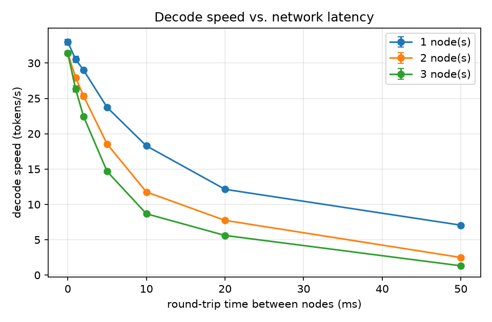
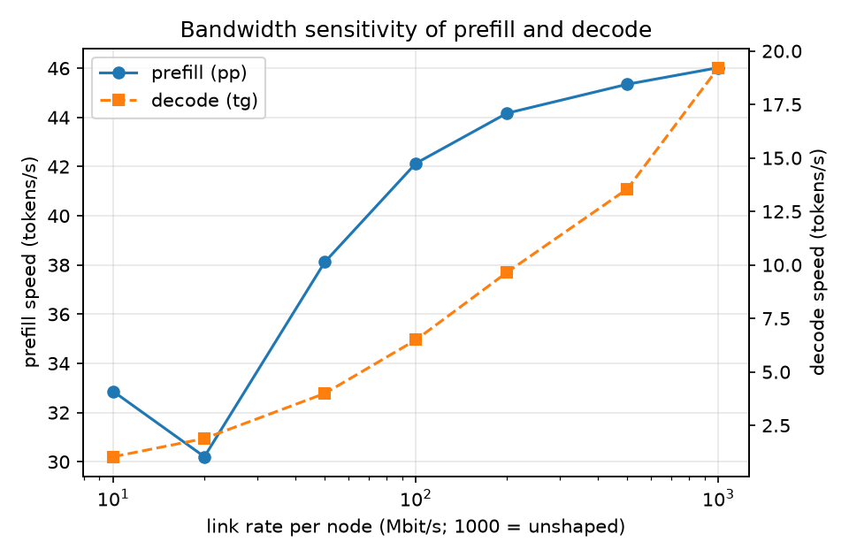
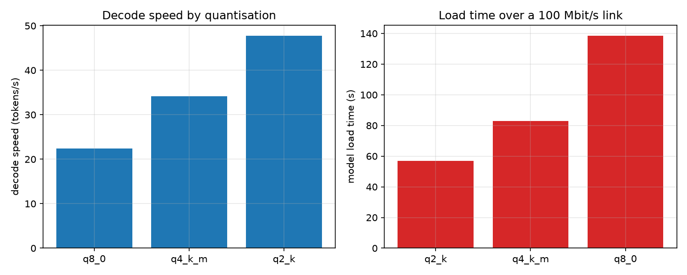
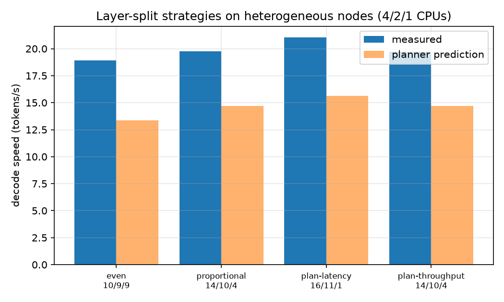

# EdgeSplit-Bench – Report

**Network-aware benchmarking and layer partitioning for distributed LLM inference on emulated edge nodes**

Author: Keshav Lohia · Date of measurements: 23.10.2026 · Code and raw data: `edgesplit/`, `results/results.csv`

---

## 1. Summary

I built a Docker testbed (1 client + 3 worker nodes) that runs a quantised LLM (Qwen2.5-1.5B-Instruct, GGUF) layer-split over the workers with llama.cpp's RPC backend. Linux `tc/netem` emulates latency and bandwidth limits, and Docker CPU quotas emulate weaker devices. A Python pipeline automates five experiments, fits a simple communication model and plans layer splits.

Main findings (all numbers measured on one laptop, see Section 6 for limitations):

1. **Latency hurts decode strongly, and more nodes make it worse more than linearly.** At 20 ms RTT, decode drops by 63 % / 75 % / 82 % with 1 / 2 / 3 nodes. The extra time per token at 50 ms grows roughly like 1 : 3.3 : 6.6 with the number of nodes.
2. **Decode is also very sensitive to bandwidth – more than prefill.** At 100 Mbit/s decode keeps only 34 % of its speed, prefill 92 %. The slow-down matches the transfer of roughly **two logits-sized tensors (~2 × 608 KB) per token** at low link rates. This is a hypothesis consistent with the data, not yet verified by a byte counter (Section 5).
3. **Quantisation speeds up decode by 2.1× (Q8_0 → Q2_K) on an unshaped link, but on a 100 Mbit/s link all three variants decode at nearly the same speed (7.0–8.4 tokens/s)**, because the network is the bottleneck. Model **load time** over the network scales with file size (57 s / 83 s / 139 s at 100 Mbit/s).
4. **A profiling-driven planner chose the best split on heterogeneous nodes.** Its split gave +11 % decode and +49 % prefill over an even split. Absolute predictions were 25–29 % too low, but the ranking of strategies was predicted correctly.
5. **Splitting did not make single-stream decoding faster in any experiment** – every 3-node split was slower than the strongest node alone (30.9 tokens/s). Splitting only pays when the model does not fit on one node.

## 2. Setup

| Item | Value |
|---|---|
| Host | Laptop, Intel Core i9-14900HX (hybrid: 8 performance + 16 efficiency cores, 32 hardware threads), 14 GiB RAM, Ubuntu 26.04.1 LTS |
| Software | Docker Compose v5.6.1; llama.cpp release **b6000** (commit `4762ad7316dcdec20016ab5985fb46a27902204d`), built with `-DGGML_RPC=ON`, CPU backend |
| Nodes | `es-client` (4 CPUs) and workers `es-w1..w3` (4 CPUs each unless stated; E5: 4 / 2 / 1). The limit is a Docker CPU quota (`--cpus`), not core pinning |
| Model | Qwen2.5-1.5B-Instruct (28 layers, hidden size 1536), GGUF Q2_K / Q4_K_M / Q8_0 |
| Benchmark | `llama-bench`, 3 repetitions, prefill (pp) with 64 prompt tokens (E3: 128), decode (tg) with 32 generated tokens, batch size 1 |
| Network emulation | `tc qdisc netem` on the egress of every container: delay = RTT/2 per node (so RTT between any two nodes = RTT); optional `rate` limit per node. The 100 Mbit/s limit was checked with iperf3: 101 Mbit/s (sender) / 95.6 Mbit/s (receiver) over 5 s |
| Split | layer-wise (`-ts` proportions), 1–3 RPC workers; the client only coordinates |

## 3. Experiments and results

### E1 – Baseline: local vs. RPC (no network shaping)

| Setup | Prefill (tok/s) | Decode (tok/s) |
|---|---:|---:|
| Local (client only) | 163.2 | 33.1 |
| 1 worker | 102.8 | 33.8 |
| 2 workers | 103.0 | 31.7 |
| 3 workers | 102.9 | 31.7 |

Over a fast, unshaped link, decode is almost unaffected by RPC (−4 % with ≥ 2 workers), but prefill is **37 % slower** than local, probably because of serialisation and copying of the large prompt batch (not investigated further).

### E2 – Latency sweep



Decode speed (tokens/s):

| RTT (ms) | 1 node | 2 nodes | 3 nodes |
|---:|---:|---:|---:|
| 0 | 33.0 | 31.4 | 31.4 |
| 1 | 30.5 | 28.0 | 26.3 |
| 2 | 29.0 | 25.3 | 22.5 |
| 5 | 23.7 | 18.6 | 14.7 |
| 10 | 18.3 | 11.8 | 8.7 |
| 20 | 12.1 | 7.7 | 5.6 |
| 50 | 7.1 | 2.5 | 1.3 |

- Decode loses 63 % / 75 % / 82 % of its speed at 20 ms RTT (1 / 2 / 3 nodes) and 79 % / 92 % / 96 % at 50 ms.
- The extra time per token at 50 ms RTT is 111 / 370 / 732 ms. Divided by the RTT this is 2.2 / 7.4 / 14.6 sequential round trips per token. So even **one** worker needs about 2 round trips per token, and the cost grows faster than linearly with the number of nodes (ratio 1 : 3.3 : 6.6, close to 1 : 3 : 6). I did not identify the cause. A plausible reason is that in llama.cpp's RPC design the client coordinates all transfers, so more nodes mean more dependent exchanges; this would have to be confirmed in the `ggml-rpc` source.
- Prefill is much less sensitive to latency with one node (−29 % at 50 ms) but drops by 66 % / 74 % with 2 / 3 nodes.

### E3 – Bandwidth sweep (2 nodes, RTT 1 ms, 128-token prompt)



| Link rate (Mbit/s) | Prefill (tok/s) | Prefill rel. | Decode (tok/s) | Decode rel. |
|---:|---:|---:|---:|---:|
| unshaped | 46.0 | 100 % | 19.2 | 100 % |
| 500 | 45.4 | 98.5 % | 13.6 | 70.5 % |
| 200 | 44.2 | 96.0 % | 9.7 | 50.2 % |
| 100 | 42.1 | 91.5 % | 6.5 | 33.8 % |
| 50 | 38.1 | 82.8 % | 4.0 | 20.8 % |
| 20 | 30.2 | 65.6 % | 1.9 | 9.8 % |
| 10 | 32.9 | 71.4 % | 1.0 | 5.4 % |

Decode is far more bandwidth-sensitive than prefill. This was unexpected: the hidden state of one token is only 1536 × 4 B = 6 KB, which would cost 0.5 ms at 100 Mbit/s, but the measured extra time per token is about 100 ms. Comparing the extra time per token with the transfer time of the output logits (vocabulary 151 936 × 4 B ≈ 608 KB):

| Link rate (Mbit/s) | Extra time per token (ms) | Transfer time of one logits tensor (ms) | Ratio |
|---:|---:|---:|---:|
| 200 | 51.6 | 24.3 | 2.12 |
| 100 | 101.8 | 48.6 | 2.09 |
| 50 | 198.0 | 97.2 | 2.04 |
| 20 | 477.1 | 243.1 | 1.96 |
| 10 | 909.5 | 486.2 | 1.87 |

At low link rates the extra time is about twice the transfer time of one logits tensor. Independently, the fitted data-volume factor in the model (β ≈ 98, Section 4) is close to the ratio logits size / hidden-state size (≈ 99). Both observations fit the hypothesis that **roughly two logits-sized transfers cross the network per generated token**, but the number of nodes was fixed at 2 in E3, so I cannot tell whether the volume scales with the number of nodes or is a constant 2 transfers. Prefill degrades only mildly and non-monotonically (the 10 Mbit/s point is faster than the 20 Mbit/s point), so prefill results in E3 are noisy.

### E4 – Quantisation (2 nodes)



| Quant | File size | Decode, unshaped (tok/s) | Prefill, unshaped (tok/s) | Load time, unshaped (s) | Load time @100 Mbit/s (s) | Decode @100 Mbit/s (tok/s) |
|---|---:|---:|---:|---:|---:|---:|
| Q2_K | 0.70 GiB | 47.8 | 135.5 | 0.7 | 56.9 | 8.4 |
| Q4_K_M | 1.04 GiB | 34.1 | 137.6 | 1.0 | 82.9 | 7.9 |
| Q8_0 | 1.76 GiB | 22.4 | 178.0 | 2.2 | 138.6 | 7.0 |

- Decode speed is roughly inversely proportional to model size: speed × size is 34–40 GiB/s for all three, which indicates that decode is **memory-bandwidth-bound**.
- Prefill is the opposite: Q8_0 is fastest (178 tok/s). Prefill is compute-bound, and the Q8_0 kernels seem cheaper per weight than the K-quant kernels (not investigated).
- Load time over a 100 Mbit/s link is about 92–94 % of file size / bandwidth (60 / 89 / 151 s). The weights are shipped to the workers over the network at every model load. That the value is slightly below 100 % is possibly because some tensors stay on the client (not verified).
- On the 100 Mbit/s link the 2.1× decode advantage of Q2_K over Q8_0 shrinks to 1.2×. **Quantising weights does not reduce the per-token network traffic**, which is why the shaped link caps decode speed for all variants.

### E5 – Heterogeneous nodes and layer partitioning (RTT 2 ms)

Nodes were limited to 4 / 2 / 1 CPUs. Each node was profiled alone, then four split strategies were measured across all three nodes. The planner assumed memory caps of 60 % / 40 % / 40 % of the layers (16 / 11 / 11 layers) – an assumption of the experiment, since all containers could in fact hold the whole model.



Profile (each node alone):

| Node | CPUs | Decode (tok/s) | Prefill (tok/s) |
|---|---:|---:|---:|
| w1 | 4 | 30.9 | 133.3 |
| w2 | 2 | 26.1 | 71.6 |
| w3 | 1 | 14.1 | 36.7 |

Halving the CPU quota barely slows decode (4 → 2 CPUs: −16 %) but nearly halves prefill (−46 %), again showing that decode is memory-bound and prefill compute-bound.

Split strategies (layers w1/w2/w3):

| Strategy | Split | Decode measured (tok/s) | Decode predicted (tok/s) | Prediction error | Prefill (tok/s) |
|---|---|---:|---:|---:|---:|
| even | 10/9/9 | 18.9 | 13.4 | −29 % | 65.1 |
| proportional to speed | 14/10/4 | 19.8 | 14.7 | −26 % | 84.2 |
| planner, latency objective | 16/11/1 | **21.0** | 15.6 | −26 % | **97.3** |
| planner, throughput objective | 14/10/4 | 19.7 | 14.7 | −25 % | 84.2 |

- The planner's split is **+11 % decode and +49 % prefill** faster than the even split; the proportional split gains +4 % and +29 %. The ranking even < proportional < planner was predicted correctly.
- The two runs with the same split (14/10/4) agree within 0.2 % (19.76 vs. 19.72 tok/s), which gives an idea of the repeatability within one session.
- The planner under-predicts absolute speed by about 25–29 %. It uses a per-hop cost derived from the model fit in Section 4 (14.0 ms at 2 ms RTT), but E2 shows that adding one node at 2 ms RTT costs only about 5 ms per token (29.0 → 25.3 → 22.5 tok/s for 1 → 2 → 3 nodes). The planner therefore over-estimates the cost of each extra node.
- The best 3-node split (21.0 tok/s) is slower than node w1 alone (30.9 tok/s). For a single request, splitting the model never helped; it would only be necessary if the model did not fit on one node.
- The "throughput" objective chose the same split as the proportional one. llama.cpp's RPC backend does not pipeline several requests, so the benefit of this objective could not be measured here (it is covered by unit tests only).

## 4. Analytical model

For decode with `n` RPC nodes I fitted `t_token = t0 + n · (o + k · RTT + β · 8 · D / BW)` with `D` = hidden-state bytes (6144 B) to all E1–E3 points (Q4_K_M, 31 measurements):

| Parameter | Value | Meaning |
|---|---:|---|
| t0 | 8.4 ms | compute-like intercept |
| o | 5.7 ms | fixed overhead per node |
| k | 4.15 | round trips per node and token |
| β | 97.6 | data volume relative to one hidden state per node-hop |
| R² | 0.972 | in per-token time |
| MAPE | 25.7 % | in per-token time |

The fit captures the trends (large k, large β), but it is **not accurate in the fast regime**: expressed as tokens/s, the prediction error is 24 % at the median and up to 116 % for the unshaped single-node case, with over-prediction at low latency and under-prediction at high latency. The reasons are visible in the data: the fit is dominated by the slowest points (unweighted least squares in the time domain), `t0` came out much smaller than the real single-node time (≈ 30 ms), and the cost grows faster than linearly with `n` (E2), which the model cannot represent. Improvements for future work: weight the fit by relative error, fit latency and bandwidth regimes separately, and add a term that grows with `n²`.

## 5. Discussion

- **What limits distributed decode here?** Not compute. With an unshaped link, going from 1 to 3 workers costs only ~4 %. Once the network has latency or limited bandwidth, decode is dominated by the number of dependent round trips (k ≈ 2–5 per node and token) and by data volume per token that is much larger than a hidden state. This matters for industrial networks: a few milliseconds of RTT already cost 10–30 % of decode speed.
- **Why is prefill less affected?** It is compute-bound and amortises round trips over many tokens, but it pays a fixed penalty for RPC even on a fast link (E1: −37 %).
- **Quantisation on a distributed setup.** It speeds up memory-bound decode and shortens the one-off load time, but it does not shrink per-token network traffic (E4). Reducing the traffic would need compression of the transferred activations/logits or avoiding the transfer (e.g. keeping the output layer on the client), which I did not test.
- **Planning.** Even a simple profile + exhaustive search over layer splits gave a clear gain on heterogeneous nodes (E5), because it fills the fast nodes first and keeps the slow node's share small. The cost model must include the per-node hop cost, otherwise the planner would spread layers over too many nodes.

**Open question (not verified):** the byte count per token. A check with the interface counters of the client container (difference of rx+tx bytes between a 32-token and a 96-token run) would confirm or reject the logits hypothesis, and E3 should be repeated with 1 and 3 nodes.

## 6. Limitations (threats to validity)

- **One machine with a hybrid CPU.** All containers share the same CPU and memory bus. The i9-14900HX has fast performance cores and slower efficiency cores, and a Docker CPU quota does not pin a container to specific cores, so the operating system may run the same container on different core types in different runs. This may contribute to the session drift described below; I did not test it. CPU quotas emulate weaker devices only roughly (memory-bound decode is not slowed down by a quota as much as compute is, see E5 profile), and `netem` is an emulation: no jitter, packet loss or wireless behaviour.
- **Session drift.** The same nominal setting gave different results in different sessions: prefill with 2 nodes and no shaping is 103 tok/s in E1/E2 but 138 tok/s in E4, decode 31.4 vs. 34.1 tok/s. Comparisons **within** one experiment are therefore more reliable than comparisons **across** experiments. Experiments were not interleaved or randomised.
- **E3 reference point.** The unshaped E3 reference (2 nodes, 1 ms RTT) gave 19.2 tok/s decode and 46 tok/s prefill, but the equivalent E2 point gave 28.0 and 101 tok/s. The only known difference is the prompt length (128 instead of 64). I did not resolve this. E3 conclusions therefore rely on relative changes inside E3; the ratio to the logits transfer time converges to ≈ 2 at low link rates but is larger at high rates, where other overheads dominate.
- **Statistics.** Three repetitions per point within `llama-bench` (standard deviations are in the CSV); one session per configuration, no confidence intervals.
- **Scope.** Batch size 1, one model family, CPU backend only, llama.cpp release b6000 (the RPC backend is experimental and its behaviour may differ in other versions), memory caps in E5 are assumed, not enforced.

## 7. Reproduce

```bash
pip install -r requirements.txt
bash scripts/download_models.sh
docker compose -f docker/docker-compose.yml build && docker compose -f docker/docker-compose.yml up -d
python -m edgesplit.experiments e1   # also e2 e3 e4 e5, then: reset
python -m edgesplit.analysis fit
python -m edgesplit.plots            # figures in results/figures
```

## 8. Next steps

1. Verify the bytes-per-token hypothesis with interface counters, repeat E3 with 1 and 3 nodes, and resolve the E3 reference discrepancy (control run with 64 and 128 prompt tokens on an unshaped link).
2. Fix the model: relative-error weighting, an `n²` term, separate latency and bandwidth regimes; re-evaluate the planner's per-hop cost.
3. Reduce network traffic: compress activations/logits (e.g. 8-bit), or keep the output layer on the client; measure the trade-off between traffic and quality.
4. Multi-request pipelining and speculative decoding with a small model on the edge, which are the cases where splitting can improve throughput rather than only fit the model.
5. Make the measurements more repeatable: pin each container to fixed cores (`--cpuset-cpus`, e.g. performance cores only), interleave or randomise the order of runs and repeat each configuration in several sessions.
6. Real devices (e.g. Raspberry Pi / Jetson), jitter, loss and a wireless link model.
